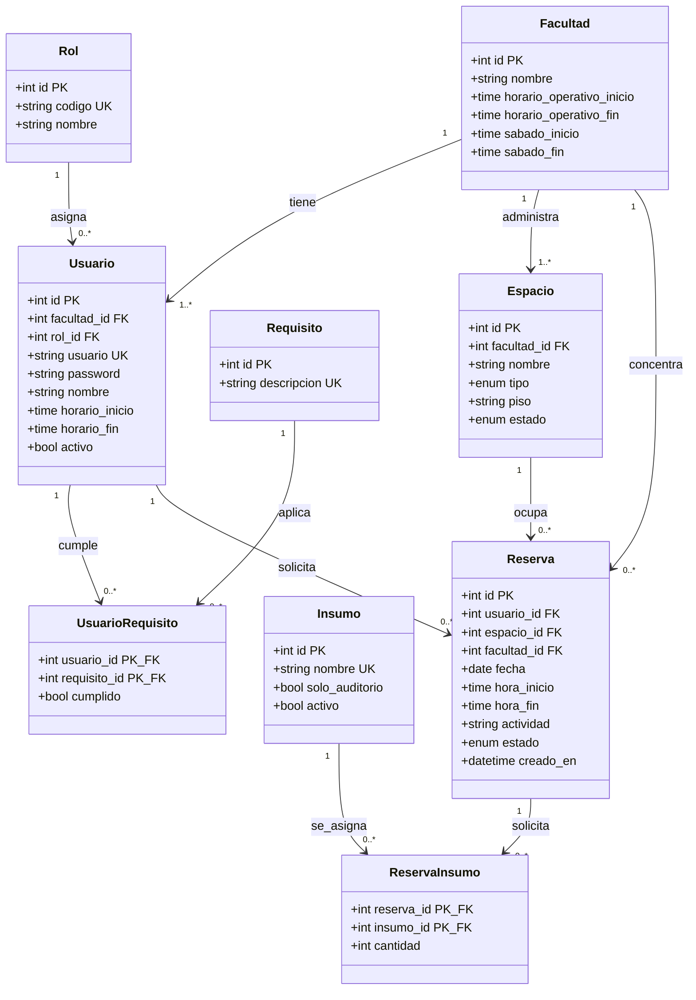

# Diagrama de clases — base de datos AulasHub (FCA)

El prototipo actual usa arreglos PHP (`models/Usuario.php`, `models/Aula.php`, `models/Reserva.php`) y un seed en `seed/usuarios.sql`. Este diagrama describe **cómo debe persistir** ese modelo al pasar a una base relacional, con claves, tipos y cardinalidades.

## Tipos y catálogos

| Entidad | Campos clave | Valores de negocio |
|---|---|---|
| `Rol.codigo` | `admin`, `consulta` | Administrativo vs docente/usuario |
| `Espacio.tipo` | `Aula`, `Auditorio`, `Sala de juntas` | 1 aula, 1 auditorio, 1 sala 1er piso, 1 sala 2do piso |
| `Insumo.solo_auditorio` | `true` solo en Presídium | No se ofrece ni se guarda en aulas/salas |
| `Insumo.nombre` | sin “sillas” | Catálogo actualizado |
| `Espacio.estado` | `Disponible`, `Ocupada`, `Mantenimiento` | Filtro de salas disponibles |
| `Reserva.estado` | `Pendiente`, `Confirmada`, `En curso`, `Completada`, `Cancelada` | Ciclo de vida |
| `Usuario.horario_inicio/fin` | `TIME` | Ventana autorizada por perfil |
| `Reserva.hora_inicio/fin` | `TIME` | Intervalo real del evento |
| `Reserva.actividad` | `VARCHAR` | Motivo mostrado en el calendario |

## Flujo de reservas, disponibilidad y validación

1. El usuario se autentica (`Usuario.usuario` + `password`). El `Rol` determina si entra a vista docente o administrativa; **no se muestra en la UI**.
2. Al crear una reserva se elige `Espacio`, `fecha`, `hora_inicio`, `hora_fin` y `actividad`.
3. Validaciones:
   - `hora_fin > hora_inicio`
   - el intervalo cabe en el horario operativo de la `Facultad` (lun–vie / sábado)
   - el intervalo cabe en `Usuario.horario_inicio`–`horario_fin`
   - no hay traslape con otra `Reserva` del mismo `espacio_id` y `fecha` cuyo `estado <> Cancelada` (`hora_inicio_A < hora_fin_B AND hora_inicio_B < hora_fin_A`)
4. Disponibilidad: un espacio está **disponible** en un intervalo si su `estado` no es `Mantenimiento` y no existe reserva activa que se traslape.
5. Reportes: el **reporte del día** filtra `Reserva` por `fecha` (y opcionalmente por `espacio_id` / solo disponibles). El **calendario mensual** agrupa por día y pinta `actividad` + sala + horario.
6. Exportación PDF: se genera en el cliente (`jsPDF`) a partir de las reservas ya cargadas. No persiste el archivo.

Índice recomendado para choques: `(espacio_id, fecha, hora_inicio, hora_fin)` más filtro de `estado`.

## Exportación PDF — ¿cambia la base de datos?

**No.** El PDF de “Reporte del día” no exige tablas ni campos nuevos.

Los datos del documento ya existen en el modelo:

- Fecha, hora inicio/fin, espacio, actividad, solicitante y estado → `Reserva` + `Usuario` + `Espacio`
- Filtro “todas las salas / sala específica / solo disponibles” → parámetros de consulta, no columnas
- Fecha/hora de generación del PDF → se escribe en el pie del documento al exportar

Si más adelante se quisiera **auditar** quién descargó cada reporte, entonces sí se añadiría algo como `ExportacionReporte` (`usuario_id`, `fecha_reporte`, `filtro_sala`, `generado_en`). Eso es opcional y **no forma parte del esquema actual**.

## Insumos (Presídium y sillas) — ¿cambia la estructura de tablas?

**No hace falta una tabla nueva.** Las reglas caben en el catálogo `Insumo` y en validación de aplicación (o un `CHECK`/trigger al persistir):

- **Sillas:** no existe en el catálogo ni en seeds (`seed/insumos.sql`). No hay columna que borrar; solo dejar de insertar ese registro.
- **Presídium:** un insumo más con `solo_auditorio = true`. Al guardar `ReservaInsumo`, rechazar Presídium si `Espacio.tipo <> 'Auditorio'`.
- **Salas de juntas:** son **datos** de `Espacio` (1er piso y 2do piso), no un cambio de columnas. Restricción recomendada: no duplicar `tipo = 'Sala de juntas'` para el mismo `piso`.

El diagrama de clases **no agrega entidades**; solo el atributo `Insumo.solo_auditorio`.
